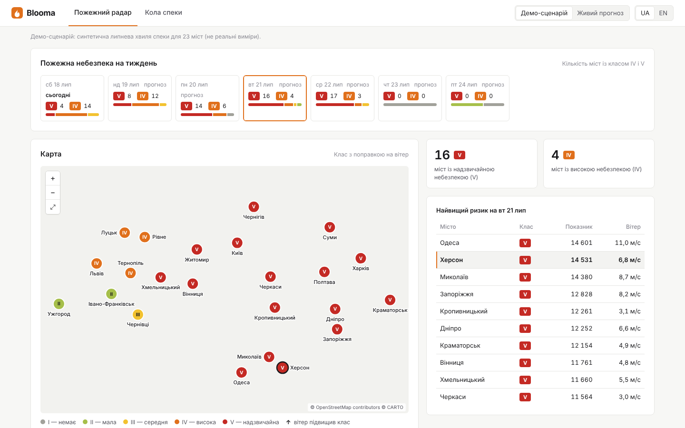
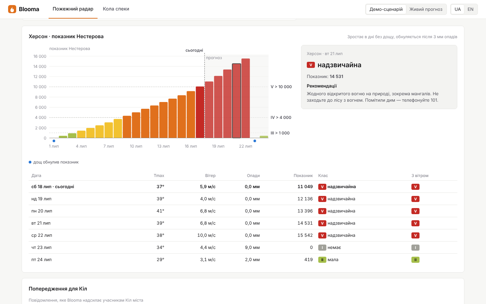
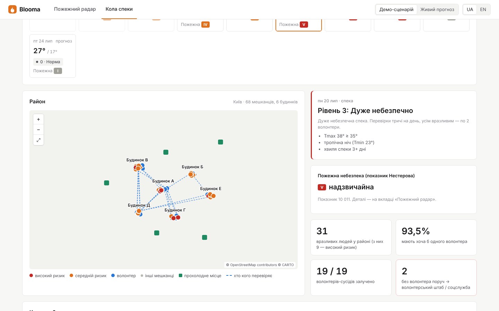
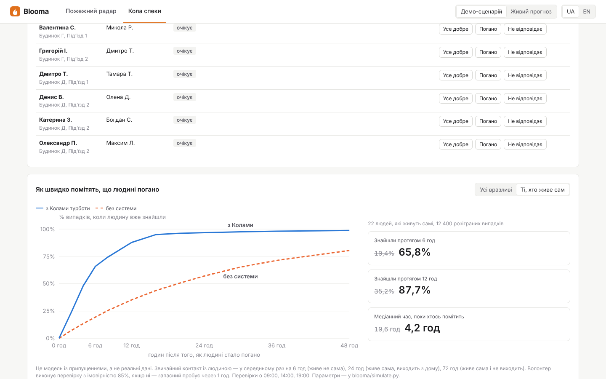
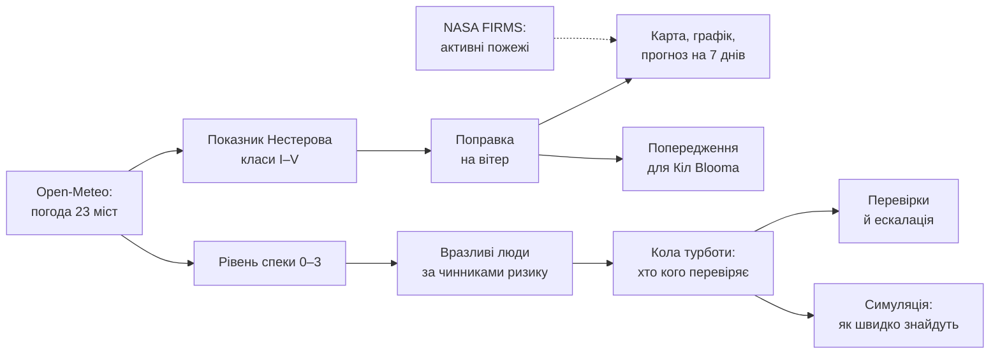
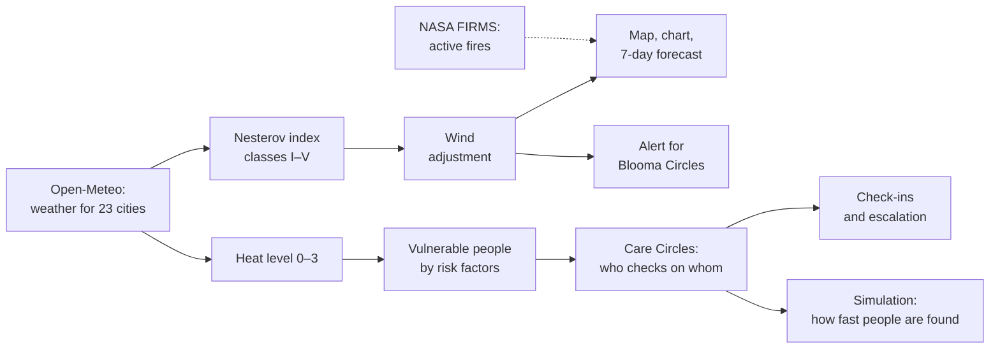

# Blooma Radar

**[Українська](#українська) · [English](#english)**

Пожежна небезпека за погодою для 23 міст України та сусідська допомога під час спеки.

Weather-based wildfire danger for 23 Ukrainian cities and neighbour care during heatwaves.



---

## Українська

### Що це

**Blooma: Пожежний радар** — вебзастосунок, який показує пожежну небезпеку за погодою для 23 міст України на тиждень уперед і допомагає громаді реагувати разом.

Дві вкладки:

1. **Пожежний радар.** Інтерактивна карта України (масштаб коліщатком або кнопками, перетягування) з класами пожежної небезпеки I–V (показник Нестерова) для обласних центрів. Є поправка на вітер, графік показника за місяць, прогноз на 7 днів і готове попередження для спільнот (Кіл) Blooma. За бажанням показує активні пожежі із супутників NASA.
2. **Кола спеки.** Під час небезпечної спеки система знаходить у районі найвразливіших людей (живуть самі, верхній поверх, без кондиціонера…) і призначає кожному 1–2 сусідів-волонтерів, які перевіряють їх кілька разів на день. Якщо людина не відповідає, перевірку передають запасному волонтеру, а далі — 103/112.

Інтерфейс — українською та англійською (перемикач UA/EN).

| Показник Нестерова по місту | Кола турботи | Симуляція |
|---|---|---|
|  |  |  |

### Проблема

- **Пожежі.** За даними Держстату (з посиланням на ДСНС), у 2023 році в Україні сталося 1 278 лісових пожеж — на 21,5% більше, ніж у 2022-му [5]. За словами ДСНС, масштабні пожежі в природних екосистемах найчастіше спричиняє людська легковажність: палять суху траву й сміття, кидають недопалки [10]. Попередження про небезпеку існують, але до людей вони доходять погано.
- **Спека.** Під час хвиль спеки люди гинуть не лише від температури, а й тому, що поруч нікого немає. У Чикаго 1995 року ризик смерті був у 6,7 раза вищим у тих, хто не виходив з дому щодня, і в 2,3 раза — у тих, хто жив сам [1]. Під час наступної хвилі спеки в Чикаго (1999) 53% загиблих були молодші за 65 років, а найсильнішим чинником ризику було самотнє проживання [2].

Blooma — це платформа, яка об'єднує людей у локальні спільноти («Кола»: місто → район → будинок → під'їзд, школа, гуртожиток). Цей проєкт використовує ці Кола для того, щоб попередження про пожежі й допомога під час спеки доходили до конкретних людей.

### Швидкий запуск

Потрібен **Python 3.10 або новіший**.

```bash
python run.py
```

```bash
python run.py --port 8080
python run.py --no-browser
python -m unittest
pip install -e .
```

### Режими даних

| Режим | Що показує | Інтернет |
|---|---|---|
| **Демо-сценарій** (за замовчуванням) | Синтетична липнева хвиля спеки для 23 міст і вигаданий район із 68 мешканцями. Зручно для показу будь-якої пори року. | не потрібен (лише для фону карти) |
| **Живий прогноз** | Реальна погода Open-Meteo: 30 днів назад і 7 днів уперед для всіх міст; прохолодні місця з OpenStreetMap. | потрібен |

Поза спекотним сезоном у живому режимі небезпека зазвичай низька — це нормально. Для «Кіл спеки» є перемикач **«План для рівня»**, щоб побачити план для будь-якого міста.

#### Активні пожежі із супутника (необов'язково)

1. Отримайте безкоштовний ключ MAP_KEY: <https://firms.modaps.eosdis.nasa.gov/api/map_key/>
2. Запустіть із ключем:
   - **Windows (PowerShell):** `$env:FIRMS_MAP_KEY="ваш_ключ"; python run.py`
   - **Windows (cmd):** `set FIRMS_MAP_KEY=ваш_ключ && python run.py`
   - **macOS / Linux:** `FIRMS_MAP_KEY=ваш_ключ python run.py`
3. Увімкніть «Живий прогноз» — на карті з'являться точки пожеж за останні 2 доби.

### Як це працює



#### 1. Пожежна небезпека — показник Нестерова

Цей показник використовують для оцінки пожежної небезпеки в лісах за погодою [4]:

```
G = Σ t13 · (t13 − td13)   — сума за всі дні без дощу
```

`t13` — температура о 13:00, `td13` — точка роси о 13:00. Дощ від 3 мм обнуляє суму. Що спекотніше й сухіше повітря і що довше немає дощу, то вищий показник.

| Клас | Показник G | Небезпека |
|---|---|---|
| I | ≤ 300 | немає |
| II | 301–1 000 | мала |
| III | 1 001–4 000 | середня |
| IV | 4 001–10 000 | висока |
| V | > 10 000 | надзвичайна |

Код: [`blooma/risk.py`](blooma/risk.py).

#### 2. Поправка на вітер (власна ідея проєкту)

Показник Нестерова не враховує вітер, хоча саме вітер робить пожежу некерованою. Тому ми рахуємо **клас поширення**: якщо клас уже III або вищий і максимальний вітер ≥ 7 м/с (≈ 25 км/год), клас підвищується на 1 (не вище V). На карті такі міста позначено стрілкою ↑.

Це евристика, а не офіційна шкала, і її ще треба перевірити на історичних даних про пожежі (див. «Що далі»). Код: [`blooma/fire.py`](blooma/fire.py).

#### 3. Рівень спеки

| Рівень | Умова |
|---|---|
| 0 — норма | Tmax < 30 °C |
| 1 — увага | Tmax ≥ 30 °C |
| 2 — небезпечно | Tmax ≥ 35 °C, **або** ≥ 30 °C разом із тропічною ніччю (Tmin ≥ 20 °C, індекс TR20 [7]) чи хвилею спеки (3+ спекотні дні поспіль) |
| 3 — дуже небезпечно | Tmax ≥ 35 °C разом із тропічною ніччю або хвилею спеки |

Кола турботи вмикаються з рівня 2.

#### 4. Хто вразливий

Бал ризику рахується як у логістичній регресії — сума натуральних логарифмів відношень шансів (OR) з дослідження хвилі спеки в Чикаго [1]:

| Чинник | OR | Вага ln(OR) |
|---|---|---|
| не виходить з дому щодня | 6,7 | 1,90 |
| прикутий(а) до ліжка | 5,5 | 1,70 |
| живе на верхньому поверсі | 4,7 | 1,55 |
| не може себе обслуговувати | 4,1 | 1,41 |
| немає кондиціонера (кондиціонер: OR 0,3) | 1/0,3 | 1,20 |
| живе сам(а) | 2,3 | 0,83 |

Бал ≥ 3,0 — високий ризик, ≥ 2,0 — середній. Пороги підібрано так, щоб один побутовий чинник (лише «без кондиціонера» або лише «верхній поверх») не робив людину вразливою, а поєднання — робило. Вік окремо не враховано: у дослідженні пари підбирали за віком, тому його вплив там не оцінено. Код: [`blooma/people.py`](blooma/people.py).

#### 5. Кола турботи — кому кого перевіряти

Людей уже об'єднано в дерево Кіл Blooma: місто → район → будинок → під'їзд. Для кожної вразливої людини (від найвищого балу до найнижчого) обирається волонтер із найбільшим балом:

```
бал = 1,0 · глибина спільного Кола − 2,0 · відстань (км) − 0,5 · вже призначені люди
```

Обмеження: волонтер — сусід із низьким ризиком, який дав згоду; не далі 1 км (у спеку довго йти теж небезпечно); не більше 3 людей на одного волонтера. Людям із високим ризиком, а на рівні 3 — усім вразливим, призначають двох волонтерів. Тих, кому волонтера не знайшлося, система показує окремо, щоб передати волонтерському штабу чи соцслужбі. Код: [`blooma/circles.py`](blooma/circles.py).

#### 6. Перевірки й ескалація

Рівень 2: перевірки о 10:00 і 18:00, рівень 3: о 09:00, 14:00 і 19:00. Результат перевірки: «усе добре», «погано» (поради першої допомоги, 103) або «не відповідає» — тоді перевірку передають запасному волонтеру, а після нього — ескалація (родичі, 103/112). Код: [`blooma/checkins.py`](blooma/checkins.py).

#### 7. Симуляція

Чи дає це щось? Ми змоделювали методом Монте-Карло, через скільки годин хтось помітить, що людині стало погано, із системою і без неї. Без системи людину помічають лише під час звичайних контактів (у середньому раз на 6 год, якщо живе не сама; 24 год — живе сама, але виходить з дому; 72 год — живе сама й не виходить). Із системою додаються перевірки за розкладом: волонтер виконує перевірку з імовірністю 85%, інакше через годину пробує запасний.

Результат для демо-району (рівень 2, 31 вразлива людина, 12 400 випадків):

| | Без системи | З Колами турботи |
|---|---|---|
| Знайшли протягом 12 год — усі вразливі | 49,7% | 87,1% |
| Медіанний час — усі вразливі | 12,1 год | 4,6 год |
| Знайшли протягом 12 год — ті, хто живе сам | 35,1% | 83,1% |
| Медіанний час — ті, хто живе сам | 19,7 год | 5,6 год |

**Важливо:** це модель із припущеннями, а не реальні дані. Вона показує, як параметри впливають на результат, але не доводить, що система працює в житті. Параметри — у [`blooma/simulate.py`](blooma/simulate.py).

### Розробка

```bash
python -m unittest -v
ruff check .
ruff format .
```

GitHub Actions запускає лінтер і тести на Windows і Linux для Python 3.10 і 3.13.

### API

Усі відповіді — повний стан застосунку в JSON.

| Метод | Шлях | Тіло |
|---|---|---|
| GET | `/api/state` | — |
| POST | `/api/mode` | `{"mode": "demo" \| "live"}` |
| POST | `/api/fire/date` | `{"date": "2026-07-20"}` |
| POST | `/api/fire/city` | `{"city": "Херсон"}` |
| POST | `/api/heat/city` | `{"city": "Київ"}` |
| POST | `/api/heat/day` | `{"date": "2026-07-20"}` |
| POST | `/api/heat/force` | `{"level": "auto" \| 2 \| 3}` |
| POST | `/api/heat/check` | `{"id": "p001@10:00", "result": "ok" \| "help" \| "no_answer"}` |
| POST | `/api/heat/reset` | `{}` |

### Обмеження

- Демо-погода синтетична, а мешканці вигадані.
- Поправку на вітер і пороги вразливості не перевірено на реальних даних.
- Показник Нестерова розроблено для лісів. Для степу, полів і міських пустирів він може бути менш точним.
- Погоду беремо в точці обласного центру, а не для всієї області.
- Супутникові «пожежі» в зоні бойових дій здебільшого спричинені обстрілами.
- Симуляція спирається на припущення про частоту контактів і надійність волонтерів.

### Приватність і безпека (для справжнього запуску)

- Людина сама вказує чинники ризику й дає згоду. Без згоди її не додають у Коло.
- Відомості про здоров'я — чутливі дані (за GDPR це особлива категорія), тому зберігається мінімум.
- Волонтер бачить лише ім'я, під'їзд і поверх людини, яку перевіряє, а не її чинники ризику.
- Система не замінює екстрені служби: за ознак теплового удару — 103, при пожежі — 101.

### Що далі

1. **Перевірити поправку на вітер на історичних даних.** Порівняти класи за 2019–2025 роки з реальними пожежами NASA FIRMS в областях далеко від фронту (ROC-AUC з поправкою і без неї).
2. Погода для всієї області, а не лише для обласного центру.
3. Сповіщення в мобільному застосунку Blooma й автоматичне збирання волонтерів.
4. Пілот у реальному будинку чи гуртожитку після згоди мешканців.

### Використання ШІ

Код і тести було написано з допомогою ШІ-асистента Claude (Anthropic). Шаблон документації допомагав готувати ШІ, а ми його доопрацювали, заповнили та відредагували. Ідею, вибір методів, перевірку результатів і тестування застосунку виконала команда.
### Автори

Краснопольський Марк Антонович, Яременко Олександр Ігорович.

### Джерела

1. Semenza J. C. et al. Heat-related deaths during the July 1995 heat wave in Chicago // *N Engl J Med*. 1996. Vol. 335. P. 84–90. <https://pubmed.ncbi.nlm.nih.gov/8649494/>
2. Naughton M. P. et al. Heat-related mortality during a 1999 heat wave in Chicago // *Am J Prev Med*. 2002. <https://pubmed.ncbi.nlm.nih.gov/11988377>
3. Reid C. E. et al. Mapping community determinants of heat vulnerability // *Environ Health Perspect*. 2009. <https://pmc.ncbi.nlm.nih.gov/articles/PMC2801183>
4. Нестеров В. Г. Горимость леса и методы её определения. М.; Л.: Гослесбумиздат, 1949.
5. Tomchenko O. et al. Geoinformation wildfire mapping of Ukraine: analyzing FIRMS data for effective fire management // *Geodesy and Cartography*. <https://journals.vilniustech.lt/index.php/GAC/article/download/21322/13132>
6. NASA FIRMS — Fire Information for Resource Management System. <https://firms.modaps.eosdis.nasa.gov/>
7. ETCCDI — Climate Change Indices (TR20, тропічні ночі). <https://etccdi.pacificclimate.org/list_27_indices.shtml>
8. Open-Meteo — Free Weather API. <https://open-meteo.com/en/docs>
9. OpenStreetMap та Overpass API. <https://www.openstreetmap.org/copyright>
10. ДСНС оголосила найвищий рівень пожежної небезпеки в Україні // Zaxid.net. <https://zaxid.net/dsns_ogolosila_nayvishhiy_riven_pozhezhnoyi_nebezpeki_v_ukrayini_n1507602>

## English

### What it is

**Blooma: Wildfire Radar** is a web app that shows weather-based wildfire danger for 23 Ukrainian cities a week ahead and helps communities respond together.

Two tabs:

1. **Wildfire radar.** An interactive map of Ukraine (zoom with the scroll wheel or buttons, drag to pan) with fire danger classes I–V (Nesterov index) for regional centres. It adds a wind adjustment, a one-month chart of the index, a 7-day forecast and a ready-made alert for Blooma communities (Circles). Optionally it shows active fires from NASA satellites.
2. **Heat Circles.** During dangerous heat the system finds the most vulnerable people in a district (living alone, top floor, no air conditioning…) and assigns each of them 1–2 neighbour volunteers who check on them several times a day. If a person doesn't answer, the check passes to a backup volunteer and then to 103/112.

The interface is available in Ukrainian and English (UA/EN switch).

| Nesterov index by city | Care Circles | Simulation |
|---|---|---|
|  |  |  |

### The problem

- **Wildfires.** According to the State Statistics Service of Ukraine (citing the State Emergency Service), Ukraine had 1,278 forest fires in 2023, 21.5% more than in 2022 [5]. According to the State Emergency Service, large fires in natural ecosystems are most often caused by human carelessness: people burn dry grass and rubbish and throw away cigarette butts [10]. Danger warnings exist, but they rarely reach people.
- **Heat.** In heatwaves people die not only from the temperature but because nobody is around. In Chicago in 1995 the risk of death was 6.7 times higher for people who didn't leave home daily and 2.3 times higher for people who lived alone [1]. In the next Chicago heatwave (1999) 53% of the victims were under 65, and living alone was the strongest risk factor [2].

Blooma is a platform that connects people in local communities ("Circles": city → district → building → entrance, school, dorm). This project uses those Circles so that fire alerts and heat help reach specific people.

### Quick start

Requires **Python 3.10 or newer**.

```bash
python run.py
```

```bash
python run.py --port 8080
python run.py --no-browser
python -m unittest
pip install -e .
```

### Data modes

| Mode | What it shows | Internet |
|---|---|---|
| **Demo scenario** (default) | A synthetic July heatwave for 23 cities and a fictional district of 68 residents. Handy for demos at any time of year. | not needed (only for the map background) |
| **Live forecast** | Real Open-Meteo weather: 30 days back and 7 days ahead for every city; cool places from OpenStreetMap. | needed |

Outside the hot season the danger in live mode is usually low — that is expected. Heat Circles have a **"Plan for level"** switch to see the plan for any city.

#### Satellite fire detections (optional)

1. Get a free MAP_KEY: <https://firms.modaps.eosdis.nasa.gov/api/map_key/>
2. Run with the key:
   - **Windows (PowerShell):** `$env:FIRMS_MAP_KEY="your_key"; python run.py`
   - **Windows (cmd):** `set FIRMS_MAP_KEY=your_key && python run.py`
   - **macOS / Linux:** `FIRMS_MAP_KEY=your_key python run.py`
3. Switch to "Live forecast" — fire detections from the last 2 days appear on the map.

### How it works



#### 1. Wildfire danger — the Nesterov index

This index is used to assess weather-based fire danger in forests [4]:

```
G = Σ t13 · (t13 − td13)   — summed over all days without rain
```

`t13` is the temperature at 13:00 and `td13` the dew point at 13:00. Rain of 3 mm or more resets the sum. The hotter and drier the air and the longer it hasn't rained, the higher the index.

| Class | Index G | Danger |
|---|---|---|
| I | ≤ 300 | none |
| II | 301–1,000 | low |
| III | 1,001–4,000 | moderate |
| IV | 4,001–10,000 | high |
| V | > 10,000 | extreme |

Code: [`blooma/risk.py`](blooma/risk.py).

#### 2. Wind adjustment (our own idea)

The Nesterov index ignores wind, although wind is what makes a fire uncontrollable. So we compute a **spread class**: if the class is already III or higher and the maximum wind is ≥ 7 m/s (≈ 25 km/h), the class goes up by one (up to V). Such cities are marked with an ↑ arrow on the map.

This is a heuristic, not an official scale, and it still has to be checked against historical fire data (see "Next steps"). Code: [`blooma/fire.py`](blooma/fire.py).

#### 3. Heat level

| Level | Condition |
|---|---|
| 0 — normal | Tmax < 30 °C |
| 1 — caution | Tmax ≥ 30 °C |
| 2 — dangerous | Tmax ≥ 35 °C, **or** ≥ 30 °C together with a tropical night (Tmin ≥ 20 °C, TR20 index [7]) or a heatwave (3+ hot days in a row) |
| 3 — very dangerous | Tmax ≥ 35 °C together with a tropical night or a heatwave |

Care Circles switch on from level 2.

#### 4. Who is vulnerable

The risk score works like a logistic regression — the sum of natural logarithms of odds ratios (OR) from the Chicago heatwave study [1]:

| Factor | OR | Weight ln(OR) |
|---|---|---|
| doesn't leave home daily | 6.7 | 1.90 |
| bedridden | 5.5 | 1.70 |
| lives on the top floor | 4.7 | 1.55 |
| can't care for self | 4.1 | 1.41 |
| no air conditioning (AC: OR 0.3) | 1/0.3 | 1.20 |
| lives alone | 2.3 | 0.83 |

A score ≥ 3.0 means high risk, ≥ 2.0 medium. The thresholds are set so that one household factor alone (only "no AC" or only "top floor") doesn't make a person vulnerable, while a combination does. Age is not scored separately: the study matched pairs by age, so its effect was not estimated there. Code: [`blooma/people.py`](blooma/people.py).

#### 5. Care Circles — who checks on whom

People are already grouped in the Blooma tree of Circles: city → district → building → entrance. For each vulnerable person (from the highest score down) the volunteer with the best score is chosen:

```
score = 1.0 · depth of the shared Circle − 2.0 · distance (km) − 0.5 · people already assigned
```

Constraints: the volunteer is a low-risk neighbour who has agreed to help; no farther than 1 km (walking far in the heat is dangerous too); at most 3 people per volunteer. People at high risk — and at level 3 every vulnerable person — get two volunteers. Those left without a volunteer are listed separately so they can be handed over to a volunteer HQ or social services. Code: [`blooma/circles.py`](blooma/circles.py).

#### 6. Check-ins and escalation

Level 2: checks at 10:00 and 18:00; level 3: at 09:00, 14:00 and 19:00. A check results in "all good", "unwell" (first-aid advice, 103) or "no answer" — then the check passes to the backup volunteer, and after that it escalates (relatives, 103/112). Code: [`blooma/checkins.py`](blooma/checkins.py).

#### 7. Simulation

Does it help? We used a Monte Carlo model to estimate how many hours pass before someone notices that a person is unwell, with and without the system. Without the system a person is noticed only during ordinary contacts (on average every 6 h if not living alone; 24 h if living alone but going out; 72 h if living alone and staying in). The system adds scheduled check-ins: a volunteer completes a check with 85% probability, otherwise a backup tries an hour later.

Results for the demo district (level 2, 31 vulnerable people, 12,400 cases):

| | Without the system | With Care Circles |
|---|---|---|
| Found within 12 h — all vulnerable | 49.7% | 87.1% |
| Median time — all vulnerable | 12.1 h | 4.6 h |
| Found within 12 h — people living alone | 35.1% | 83.1% |
| Median time — people living alone | 19.7 h | 5.6 h |

**Important:** this is a model with assumptions, not real data. It shows how the parameters affect the result but doesn't prove that the system works in real life. Parameters are in [`blooma/simulate.py`](blooma/simulate.py).

### Development

```bash
python -m unittest -v
ruff check .
ruff format .
```

GitHub Actions runs the linter and tests on Windows and Linux for Python 3.10 and 3.13.

### API

Every response is the full application state in JSON.

| Method | Path | Body |
|---|---|---|
| GET | `/api/state` | — |
| POST | `/api/mode` | `{"mode": "demo" \| "live"}` |
| POST | `/api/fire/date` | `{"date": "2026-07-20"}` |
| POST | `/api/fire/city` | `{"city": "Херсон"}` |
| POST | `/api/heat/city` | `{"city": "Київ"}` |
| POST | `/api/heat/day` | `{"date": "2026-07-20"}` |
| POST | `/api/heat/force` | `{"level": "auto" \| 2 \| 3}` |
| POST | `/api/heat/check` | `{"id": "p001@10:00", "result": "ok" \| "help" \| "no_answer"}` |
| POST | `/api/heat/reset` | `{}` |

### Limitations

- The demo weather is synthetic and the residents are fictional.
- The wind adjustment and vulnerability thresholds have not been tested on real data.
- The Nesterov index was designed for forests. For steppe, fields and urban wasteland it may be less accurate.
- Weather is taken at the regional centre, not for the whole region.
- Satellite "fires" in the combat zone are mostly caused by shelling.
- The simulation relies on assumptions about contact frequency and volunteer reliability.

### Privacy and safety (for a real launch)

- People report their own risk factors and give consent. Without consent nobody is added to a Circle.
- Health information is sensitive data (a special category under GDPR), so only the minimum is stored.
- A volunteer sees only the name, entrance and floor of the person they check on, not their risk factors.
- The system doesn't replace emergency services: signs of heatstroke — 103, fire — 101.

### Next steps

1. **Test the wind adjustment on historical data.** Compare 2019–2025 classes with real NASA FIRMS fires in regions far from the front line (ROC-AUC with and without the adjustment).
2. Weather for the whole region, not only the regional centre.
3. Notifications in the Blooma mobile app and automatic volunteer matching.
4. A pilot in a real building or dorm after residents agree.

### AI use

The code and tests were written with the help of the AI assistant Claude (Anthropic). The AI helped prepare the documentation template, which we then revised, completed and edited. The idea, choice of methods, result checking and testing of the app were done by the team.
### Authors

Mark Krasnopolskyi, Oleksandr Yaremenko.

### Sources

1. Semenza J. C. et al. Heat-related deaths during the July 1995 heat wave in Chicago // *N Engl J Med*. 1996. Vol. 335. P. 84–90. <https://pubmed.ncbi.nlm.nih.gov/8649494/>
2. Naughton M. P. et al. Heat-related mortality during a 1999 heat wave in Chicago // *Am J Prev Med*. 2002. <https://pubmed.ncbi.nlm.nih.gov/11988377>
3. Reid C. E. et al. Mapping community determinants of heat vulnerability // *Environ Health Perspect*. 2009. <https://pmc.ncbi.nlm.nih.gov/articles/PMC2801183>
4. Nesterov V. G. Forest flammability and methods for its determination. Moscow; Leningrad: Goslesbumizdat, 1949 (in Russian).
5. Tomchenko O. et al. Geoinformation wildfire mapping of Ukraine: analyzing FIRMS data for effective fire management // *Geodesy and Cartography*. <https://journals.vilniustech.lt/index.php/GAC/article/download/21322/13132>
6. NASA FIRMS — Fire Information for Resource Management System. <https://firms.modaps.eosdis.nasa.gov/>
7. ETCCDI — Climate Change Indices (TR20, tropical nights). <https://etccdi.pacificclimate.org/list_27_indices.shtml>
8. Open-Meteo — Free Weather API. <https://open-meteo.com/en/docs>
9. OpenStreetMap and Overpass API. <https://www.openstreetmap.org/copyright>
10. The State Emergency Service declared the highest level of fire danger in Ukraine // Zaxid.net (in Ukrainian). <https://zaxid.net/dsns_ogolosila_nayvishhiy_riven_pozhezhnoyi_nebezpeki_v_ukrayini_n1507602>
